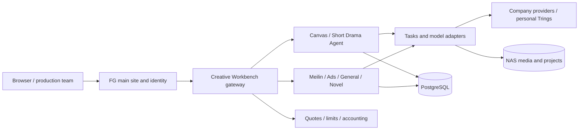

<p align="center"></p>

<h1 align="center">FG Studio</h1>

<p align="center">Turn an idea into a super video production project you can edit, organize, and continue.</p>
<p align="center"><a href="README.md">中文</a> · <strong>English</strong> · <a href="docs/releases/2026-10-07--15-user-update.md">Release notes</a> · <a href="production-lab/yingce/canvas/FG-CHANGELOG.md">Version history</a></p>

[](docs/media/fg-studio-tour-1080p60.mp4)

<p align="center"><a href="docs/media/fg-studio-tour-1080p60.mp4">▶ Full product film · 2 min 38 sec · 1080p / 60 fps</a></p>

The film includes product direction. The feature descriptions below identify the currently available capabilities.

## What is FG Studio?

FG Studio is an **AI visual creation and short-drama production platform for creators and teams**. It connects conversations, scripts, characters, locations, images, video, audio, infinite canvases, team projects, and cost records. A generated result can become the reference or production asset for the next step.

Generate a single image, explore an idea on a canvas, or start with a finished script. Establish a consistent visual direction, extract reusable assets, plan chapters and shots, review references and director prompts, then produce individual or batched outputs. Projects retain tasks, assets, versions, and cost attribution so work can be revised, reused, and handed over.

Different workflows coexist: **Short Drama Agent emphasizes production management; Meilin emphasizes continuing conversations; the free canvas supports open exploration; advertising and novel workbenches provide specialized workflows.** FG supplies shared identity, company model connections, storage, and accounting.

## Contents

- [Try it](#try-it)
- [Actual interface](#actual-interface)
- [Workspace map](#workspace-map)
- [Short Drama Agent](#short-drama-agent)
- [Meilin: a conversational director](#meilin-a-conversational-director)
- [Canvas, inspiration, and generation](#canvas-inspiration-and-generation)
- [Specialized workbenches](#specialized-workbenches)
- [Audio, skills, and reusable assets](#audio-skills-and-reusable-assets)
- [Collaboration, tasks, and costs](#collaboration-tasks-and-costs)
- [Models and personal settings](#models-and-personal-settings)
- [Updates and testing](#updates-and-testing)
- [Architecture and development](#architecture-and-development)
- [Licenses and upstream projects](#licenses-and-upstream-projects)
- [Deployment and operations](#deployment-and-operations)

## Try it

| Item | Value |
| --- | --- |
| Demo login | [Open FG Studio](https://218.61.196.139:8300/login) |
| Creative workbench | [Open the creation page](https://218.61.196.139:8300/fg-six/) |
| Company LAN | [Internal entry](https://192.168.0.99:3000/login) |
| Shared demo account | `test@beva.com` |
| Shared demo password | `123456` |
| Allowance | **¥5 total for the entire shared account**, not per visitor; it does not reset monthly. |
| Scope | Isolated creation, canvases, and short-drama tests. Company stories, shared projects, internal assets, administration, and personal credential configuration are unavailable. |

The external entry uses the existing company HTTPS service; the internal entry requires company LAN access. Certificate trust follows the deployment's setup. Other demo visitors can see the shared account's test content; use material intended for demonstration only.

The server rejects new paid requests when the allowance is insufficient, costs remain unresolved, or a reliable cost ceiling is unavailable. Existing tasks and final provider settlement may complete later. Browsing and editing remain available; a ¥5 allowance is not intended to fund an entire drama.

1. Sign in and start with **Creation** or **Free Canvas**: explore inspiration, inspect model settings, or upload test references.
2. Choose **Short Drama Agent** for structured production or **Meilin** for continuous discussion and revisions.
3. Confirm the style and character assets before generating images. Review video prompts, actual references, specifications, prices, and totals before submitting.
4. Follow existing task progress instead of repeatedly creating requests. Preserve the task ID when reporting failures.
5. Team members should use individual accounts. Personal GPT configuration is under the account menu → settings → **GPT connection**.

## Actual interface

These are screenshots of the **running application on October 15, 2026**, not design mockups. Available models, example content, and navigation depend on deployment settings and account permissions. Screenshots do not guarantee output quality for every model.

| Creation | Image workbench |
| --- | --- |
|  |  |
| Video workbench | Meilin |
|  |  |
| Free canvas | Short Drama Agent |
|  |  |
| Audio tools | Skills |
|  |  |

See the [complete screenshot gallery](docs/media/SCREENSHOTS.md) for shot production and specialized workbenches.

## Workspace map

The main FG site retains six entry points. **The sixth, FG Creative Workbench, is the currently focused production workspace.**

| Main workspace | Purpose |
| --- | --- |
| AI chat | Text and multimodal conversations, model selection, reasoning options, skills, and history. |
| Project workspace | Story bible, script, assets, shot lists, video, music, and export pages. |
| Super canvas | The existing creator, canvas, image, and video tools. |
| Preset library | Prompts, favorites, styles, and reusable production templates. |
| Administration | Usage, budgets, models, audit logs, and service reports for authorized roles. |
| FG Creative Workbench | The integrated workflows listed below. |

| Creative Workbench entry | What it supports |
| --- | --- |
| Creation | Start image, video, text, or Agent work; return to recent canvases, history, and inspiration. |
| Stories and projects | Submissions, review, selection, production ownership, teams, tiers, and budgets. |
| Short Drama Agent | Chapters → assets → shots → video prompts → outputs → editing, with versions. |
| Meilin | Conversational changes to the drama, episodes, script, style, and segment production. |
| Advertising | Product briefs, creative drafts, specialist Agents, assets, and advertising projects. |
| General creation | Tools, skills, conversations, drafts, and media tasks in an isolated runtime. |
| Novel to video | Long-form source material, characters, locations, scripts, shots, generation, and editing. |
| Free canvas | Nodes and connections for assets, references, generations, and creative branches. |
| Assets / audio / image / video / skills / plugins | Reusable resources and specialized tools outside a single project. |

## Short Drama Agent

### Scripts and chapters

Import Word `.docx`, Excel `.xlsx/.xls`, PDF, TXT, Markdown, or CSV. Review the source and formatted preview, split chapters, and confirm formatting changes. Scanned PDFs require text extraction; legacy `.doc` files must be converted. Work chapter by chapter or select several for batch processing.

### Global direction and reusable assets

Projects store aspect ratio, visual direction, and default models. Add **zero to six optional style reference images**. Character, empty-location, and single-prop prompts serve different purposes: consistent full-body character views, unoccupied spaces, and complete object presentation. Edit each prompt and reference, unify specifications, confirm assets, or generate in batches. Confirmation and prompt saving do not require immediate image generation.

Asset extraction uses `short-drama-asset-prompts`; project medium, identity, species, palette, and material constraints accompany the request. Style references and identity references have distinct roles.

### Shot planning and director prompts

Plan segments by narrative structure or a supported fixed duration for the target model. A video segment can contain several internal shots. `script-to-drama-prompt-dev` provides the default planning method; action sequences incorporate `wuxi-action-director-public` and direction checks. Existing shot plans are skipped unless replacement is explicitly selected.

Video prompts cover the concept, reference responsibilities, camera route, depth and focus, materials, color and lighting, character and background performances, action timeline, sound, and negative constraints. They describe action order, speed, physical contact, impacts, and the previous ending / next opening state: position, orientation, held props, space, light, and sound.

Enter revision feedback, optionally add a skill, preview the replacement draft, and apply it deliberately. Prompt constraints still require rendered samples and human review to evaluate pacing, consistency, and continuity.

### References, outputs, and batches

Automatically match relevant characters, locations, and necessary props, then inspect, adjust, or rematch the references. Matching cannot replace human review; unavailable files do not count as valid inputs.

Storyboard images, monochrome action previews, and shot videos retain separate prompts and versions, with descriptive names such as `Shot01-Storyboard-v1`. Inspect current outputs and prompts used by historical generations. Submit one shot or a batch after reviewing references, specifications, prices, totals, and allowance; running shots are not submitted again.

New projects default to **Image 2.5 and Seedance 2.5 / 480P**, while explicit existing selections remain intact.

## Meilin: a conversational director

Meilin combines ongoing conversation, editable project facts, episode workflows, and long-term memory.

- **Start from an idea or an existing script.** New scripts default to the Short Drama Factory skill. Existing scripts can be pasted or uploaded without repeating the AI project-intake process. Google AI Studio is an optional external drafting source.
- **Edit project facts.** Change the project card, series bible, cast, performance constraints, or visual direction. This does not automatically overwrite or regenerate existing images and videos.
- **See progress.** Creation and production actions provide immediate waiting feedback; AI responses and scripts appear progressively. Plain conversational advice is not mistaken for executable structured edits.
- **Manage episodes.** Change episode count and duration, append, insert, or delete episodes with boundary checks and confirmation. Workflow memory follows renumbering; manually written requirements remain intact.
- **Produce segments.** Review assets, prompts, references, and quotes, then follow the original FG task and retain versions and costs.
- **Continue authorized work.** Project-bound media remains usable by authorized members after an administrator contributes. Unrelated private media remains private.
- **Manage dramas.** Resume, share with authorization, or delete owned dramas. Public demo accounts cannot expand access through sharing.

| Choice | Short Drama Agent | Meilin |
| --- | --- | --- |
| Interaction | Chapter, shot, and asset forms | Conversation and editable project facts |
| Strength | Batch progress, version organization, production management | Discussion, direction changes, continuing memory |
| Best fit | Defined structure and repeatable team work | Evolving ideas and frequent revisions |
| Shared foundation | FG models, tasks, RMB costs, and resource permissions | FG models, tasks, RMB costs, and resource permissions |

## Canvas, inspiration, and generation

**Creation.** Switch between image, video, text, and Agent modes. Add references, mention assets or skills, and choose model settings. The animated orb remains, history sits above the composer, and recent canvases and inspiration appear below.

**Inspiration.** Filter images, videos, and text by purpose, source, model, or keyword. Inspect prompts, attribution, and licenses; favorite items, import/export personal inspiration, and carry an idea into creation. Background synchronization retains the last successful content when a source fails. Grid view is the default; optional **Planet roaming** provides a dense immersive gallery with dragging, scrolling, full screen, filters, and in-view details. Repeated visual placement does not inflate the unique item count. Source rights remain applicable.

**Free canvas.** Organize image, video, text, and audio nodes, connections, reference relationships, creative branches, and Agent-assisted work. Drag, zoom, rename, import/export, and save copies. Dragging nodes to an edge pans the viewport. Expanded prompt editing retains mentions and accessible video settings. Extract frames, clips, or audio from video; retained audio names help identify voices.

**3D director stage.** Arrange actors, primitive objects, models, and image boards; adjust poses, positions, cameras, lighting, and shots. Timelines, keyframes, and movement paths help check staging and provide references for later generation. This expresses camera and spatial relationships; it is separate from the proposed Blender MCP modeling integration.

**Image and video workbenches.** Dedicated parameter, reference, output, running-task, and history areas. Tools and presets assist with product images, detail views, advertising shots, and other targets. Dimensions, quality, mode, aspect ratio, duration, resolution, and audio follow the chosen model's capabilities. Closing an editor does not cancel an already-submitted background task.

## Specialized workbenches

| Workbench | Workflow |
| --- | --- |
| Advertising | Product and campaign intake, creative drafts, specialist Agents, asset canvas, and results. Drafts can populate forms; failures include reasons and costs retain project attribution. |
| General creation | Conversations, tools, skills, drafts, and media. Company skills are read-only; personal projects and runtimes are isolated. Models and accounting use FG. |
| Novel to video | Source text, project planning, characters, scenes, scripts, shots, generation, editing, and export. User runtimes and projects remain separate; slow creation recovers the original project where possible. |

These workbenches retain their upstream strengths and project structures. Availability depends on configuration. Complex automatic workflows, download-site restrictions, provider behavior, and output quality require separate validation.

## Audio, skills, and reusable assets

- **Speech and sound:** company TTS voices and real previews; text-described sound generation through Seed Audio, with channel-specific format and length validation.
- **Transcription and subtitles:** recorded and real-time recognition, segmented text, and subtitle export, with explicit disconnection and failure states.
- **Translation:** a separate machine-translation tool for dialogue, subtitles, and text.
- **Music:** the company Suno queue, submission IDs, production/archive states, playback, and audio-node reuse. Provider challenges still require a human; queue readiness is not a guarantee of upstream generation.
- **Skills:** complete packages for writing, assets, shots, acting, cinematic direction, and advertising. A listed skill alone does not prove its execution or a successful rendered result.
- **Assets:** owned and authorized company material, search, previews, versions, project binding, recycling, and restoration. Reused files and accounting history remain protected when projects are deleted.
- **Plugins:** extensions enabled by the deployment and relevant authorization; not every optional integration is enabled automatically.

## Collaboration, tasks, and costs

| Design | User-facing behavior |
| --- | --- |
| Private and shared content | Private work follows ownership; company stories follow collaboration rules. Administrative roles do not expose every administrator's private work. |
| Project-bound access | Authorized members can continue using bound material without gaining access to the contributor's unrelated private assets. |
| Editing ownership | Editing leases and takeover feedback reduce silent competing writes. |
| Background task recovery | FG and provider IDs are retained; a wait timeout does not imply that resubmission is free. |
| RMB quotes | Review individual prices, batch totals, and available allowance before submission. Capped requests with unknown ceilings are paused. |
| Actual versus estimated costs | Provider-confirmed, estimated, and unresolved amounts remain distinct, with matching evidence and manual handling. |
| Budgets | Applicable user-month and project limits govern company spending. Some company audio has a separate exemption policy; the public demo has an additional one-time cap. |
| Recycling | Free canvases have a 30-day recycle bin; project archives, shared references, and cost records remain protected. |
| Storage and operations | Media is authorized, NAS outages pause writes, and empty directories do not replace existing projects. Health, errors, usage, and periodic reports support diagnosis. |

## Models and personal settings

Individual members configure an **API URL and API Key** under account settings → GPT connection. The default URL is `https://api.ten-rings.adtensor.com/llm/v1`, model `gpt-6.1-sol`, with `high` reasoning. Keys are encrypted per account on the server; provider keys are not distributed in this README.

Personal Trings requests do not consume FG's internal allowance; upstream billing and balance belong to the personal provider account. Short Drama Agent uses Sonnet 5.5 when no personal key is bound or a definite quota exhaustion is returned. That fallback follows company billing policies. Arbitrary network errors do not trigger blind resubmission.

Company image/video channels, including WeToken GPT Image, remain separate from the GPT text migration. Model limits and prices are specific to the actual provider and model version. Personal settings also include profile/theme options as permitted. Public demo visitors cannot bind personal keys.

## Updates and testing

This cycle moved the Creative Workbench from **v1.2.18 / the October 7 v1.3.0 release to v1.3.17**. The main site maintains a separate version.

- [October 7–15: Added, Improved, Fixed, timeline, and test guide](docs/releases/2026-10-07--15-user-update.md)
- [Reviewed main-commit index](docs/releases/2026-10-07--15-commit-index.md)
- [Version-by-version history](production-lab/yingce/canvas/FG-CHANGELOG.md)

Compare Short Drama Agent and Meilin using the same 30–60 second script. Test identity/style consistency, pacing, motion, camera work, segment continuity, references, and task recovery. Include the entry point, project, model/specifications, reproduction steps, expected/actual behavior, screenshots, and task ID in feedback.

**Video depth/structure reference and Blender through MCP are proposals awaiting demand, not committed features or verified output promises.** Local GPU post-processing is disabled by default; see the [worker guide](docs/local-media-worker.md).

## Architecture and development



| Layer | Implementation |
| --- | --- |
| Main site | Next.js, React, TypeScript, shared identity and existing workspaces. |
| Creative frontend | React, Vite, TypeScript, Ant Design, canvas and editor components. |
| Native production service | Go, PostgreSQL, Redis, tasks, and media resources. |
| FG gateway | Node.js identity, models, budgets, accounting, resources, and workbench adapters. |
| Specialized services | Meilin, advertising, general creation, and novel runtimes with persistent projects. |
| Operations | Docker Compose, NAS, TLS/proxy, deployment, monitoring, and reports. |

**Run the main site locally:**

```bash
corepack enable
pnpm install
cp .env.example .env.local
pnpm dev
```

Use the repository's pinned package manager and dependency requirements. Configure PostgreSQL, model access, and media storage separately. `pnpm dev` starts the main site; it does not start every sixth-module service. Consult the [production-workbench directory](production-lab/README.md) and its subdirectory deployment documents.

| Directory | Contents |
| --- | --- |
| `app/`, `components/`, `lib/` | Main pages, APIs, identity, data, and accounting. |
| `production-lab/yingce/` | Native canvas/drama workbench and FG gateway. |
| `production-lab/meilin/` | Meilin adaptation and provenance. |
| `production-lab/adcraft/` | Advertising workbench. |
| `production-lab/opencreator/` | General creation workbench. |
| `production-lab/arcreel/` | Novel-to-video workbench. |
| `production-lab/suno/` | Company music queue. |
| `docker/`, `scripts/`, `tests/` | Migrations, operations, and validation. |
| `docs/releases/`, `docs/media/` | Releases, the film, and real screenshots. |

Configuration fields are documented in [.env.example](.env.example) and [.env.docker.example](.env.docker.example). Keep database, session, model, and tunnel credentials on the server; never commit real keys or publish them in screenshots. Read [AGENTS.md](AGENTS.md) before changing running services.

## Licenses and upstream projects

The root [LICENSE](LICENSE) covers FG-owned main-site code. **This is a multi-license repository, not an assertion that every included component is MIT.**

| Component | License / provenance |
| --- | --- |
| Open AI Canvas and its FG adaptation | [MIT and attribution](production-lab/yingce/canvas/LICENSE) |
| OpenCreator | [Apache-2.0](production-lab/opencreator/upstream/LICENSE) |
| ArcReel | [AGPL-3.0](production-lab/arcreel/upstream/LICENSE), [source record](production-lab/arcreel/SOURCE.md) |
| AdCraft | [Personal and non-commercial license](production-lab/adcraft/upstream/LICENSE); commercial use requires the relevant authorization. |
| Meilin | [Prototype provenance and adaptation boundaries](production-lab/meilin/SOURCE.md), preserving original credits. |

External inspiration, music, fonts, skills, model services, and generated content retain their respective terms. Verify component-specific obligations before deployment, redistribution, or commercial use.

## Deployment and operations

The existing deployment and operations appendix is **preserved unchanged at the bottom of the Chinese README**, so its maintainer can continue updating it in one place:

**[Deployment, Docker/NAS, automatic releases, monitoring, reports, and media access →](README.md#部署)**

This appendix is the canonical operational reference. Its service-specific commands should be run only on the intended deployment host, with the protections described in `AGENTS.md`.
