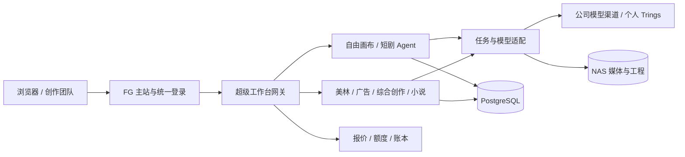

<p align="center">
  
</p>

<h1 align="center">FG Studio · FG 超级工作台</h1>

<p align="center">从一句创意，到可管理、可修改、可接续的超级视频制作项目。</p>
<p align="center"><strong>中文</strong> · <a href="README.en.md">English</a> · <a href="docs/releases/2026-10-07--15-user-update.md">本期更新</a> · <a href="production-lab/yingce/canvas/FG-CHANGELOG.md">版本记录</a></p>

[](docs/media/fg-studio-tour-1080p60.mp4)

<p align="center"><a href="docs/media/fg-studio-tour-1080p60.mp4">▶ 观看完整宣传片 · 2 分 38 秒 · 1080p / 60fps</a></p>

宣传片展示平台与产品方向；当前已开放能力以本文功能说明为准。

## FG Studio 是什么？

FG Studio 是面向创作者与制作团队的 **AI 视觉创作和短剧制作平台**。它把对话、剧本、角色与场景资产、图片、视频、声音、无限画布、团队项目和费用记录连接起来，让一次生成能够继续成为下一步制作的素材。

你可以只生成一张图，也可以从现成剧本开始，建立统一画风与人物设定，拆分章节和镜头，检查参考图与导演提示词，再逐项或批量制作。项目保留任务、素材、产物版本和费用归属，便于修改、复用以及成员之间接续。

平台同时保留不同工作方式：**短剧 Agent 负责工程化管理，美林负责持续对话共创，自由画布负责开放式组织，广告与小说工作台服务各自的制作流程。** 它们共用 FG 的账号、公司模型接入与存储基础设施，而不是要求成员分别管理多套供应商账号。

## 目录

- [体验与快速开始](#体验与快速开始)
- [真实页面](#真实页面)
- [工作区与功能导航](#工作区与功能导航)
- [短剧 Agent：可管理的制作流程](#短剧-agent可管理的制作流程)
- [美林：通过对话推进制作](#美林通过对话推进制作)
- [画布、灵感与独立生成](#画布灵感与独立生成)
- [广告、综合创作与小说转视频](#广告综合创作与小说转视频)
- [声音、技能与素材复用](#声音技能与素材复用)
- [协作、任务和费用设计](#协作任务和费用设计)
- [模型与个人设置](#模型与个人设置)
- [本期更新与测试反馈](#本期更新与测试反馈)
- [架构与开发](#架构与开发)
- [许可与上游来源](#许可与上游来源)
- [部署与运维附录](#部署)
- [目录速览](#目录速览)

## 体验与快速开始

| 项目 | 内容 |
| --- | --- |
| 体验入口 | [打开 FG Studio](https://218.61.196.139:8300/login) |
| 超级工作台 | [进入创作首页](https://218.61.196.139:8300/fg-six/) |
| 公司局域网 | [内网入口](https://192.168.0.99:3000/login) |
| 公用体验账号 | `test@beva.com` |
| 公用体验密码 | `123456` |
| 体验额度 | **整个账号共用一次性 ¥5**，不是每人 ¥5，跨月不自动恢复。 |
| 体验范围 | 隔离的独立创作、画布和短剧测试；公司故事、共享项目、内部素材、管理和个人密钥设置不开放。 |

外网入口使用现有公司 HTTPS 服务，内网入口仅在公司局域网可达；证书信任按部署要求处理。共享账号的测试内容对其他体验者可见，请只放用于公开体验的内容。额度不足、存在待确认费用或本次费用上限不明确时，服务端阻止新的收费请求；浏览与编辑不因此消失。供应商最终结算和已提交任务可能晚于生成提交时间。

**第一次使用：**

1. 登录后从「超级创作」或「超级自由画布」开始，先浏览灵感、查看设置或上传自己的测试素材。
2. 做完整短剧时，选择「短剧 Agent」；希望边聊边改时，选择「美林 · 超级导演」。两个入口都保留，不需要互相替换。
3. 先确认画风、人物和参考素材，再生成图片；先检查视频提示词、实际引用、规格、单价和合计，再确认出片。
4. 长任务到任务区查看原进度。失败时先保留任务编号并反馈，避免反复新建请求。
5. 正式成员请使用自己的账号；个人 GPT 在账户菜单 → 个人设置 →「GPT 接入」配置。

## 真实页面

以下是 **2026 年 10 月 15 日运行页面截图**，不是设计稿。页面语言、模型选项、示例内容与账号权限可能随配置变化；截图中的测试素材不等于每个模型的效果承诺。

| 创作首页 | 图片工作台 |
| --- | --- |
|  |  |
| 视频工作台 | 美林 · 超级导演 |
|  |  |
| 自由画布 | 短剧 Agent |
|  |  |
| 音频设置区 | 技能中心 |
|  |  |

镜头制作与独立工作台等更多页面见 [完整截图册](docs/media/SCREENSHOTS.md)。

## 工作区与功能导航

FG 主站保留六个工作区入口，**第六板块「FG 创作工作台」是当前集中迭代的生产工作区**。

| 主站入口 | 用途 |
| --- | --- |
| AI 对话 | 多模型文字／多模态对话、技能调用、推理选项和会话历史。 |
| 项目工作区 | 故事圣经、剧本、角色与场景、镜头、视频、配乐及导出等项目页面。 |
| 超级画布 | 原有创作台、画布、图片与视频生成入口。 |
| 预设库 | 提示词、个人收藏、风格与制作模板。 |
| 管理后台 | 用量、预算、模型、审计日志和服务报表；需相应管理权限。 |
| FG 创作工作台 | 下表中的短剧、美林、广告、综合创作、小说与自由画布等流程。 |

| 超级工作台入口 | 适合完成什么 |
| --- | --- |
| 超级创作 | 一句话开始图片、视频、文本或 Agent 创作，查看最近画布、历史对话与灵感。 |
| 故事与项目 | 投稿、审核、选题、立项，按小组、负责人、级别和预算推进团队制作。 |
| 短剧 Agent | 章节 → 资产 → 分镜 → 视频提示词 → 镜头产物 → 剪辑，集中管理版本。 |
| 美林 · 超级导演 | 持续与 AI 对话，修改全剧设定、剧集、剧本、画风和分段拍摄。 |
| 广告工作台 | 商品／广告需求、创意草稿、专业 Agent、素材和广告项目。 |
| 超级综合工作台 | 在创作运行环境中组织对话、工具、技能、草稿与媒体任务。 |
| 超级小说转视频 | 长文本／小说项目、角色与场景、剧本规划、分镜、生成和剪辑。 |
| 超级自由画布 | 用节点和连线组织素材、生成、参考关系与创意分支。 |
| 资产／音频／图片／视频／技能／插件 | 在具体任务之外管理、查找与复用制作能力。 |

## 短剧 Agent：可管理的制作流程

**导入与章节。** 支持 Word `.docx`、Excel `.xlsx/.xls`、PDF、TXT、Markdown 和 CSV，提供原文与排版预览、章节拆分及整理排版确认。扫描 PDF 需要先提取文字，旧 `.doc` 需另存为支持格式。保留逐章制作，也可选择多个章节批量提取和生成。

**全局设定与资产。** 项目保存画幅、画风和默认模型；画风参考可选 0—6 张。角色、场景、道具分别生成可编辑的资产提示词：角色强调同身份全身三视图，场景强调无人空间，道具强调单件完整展示。支持批量确认、逐项改 Prompt／参考图、统一规格和批量生图，并保留只确认和只保存提示词入口。

**分镜规划。** 根据目标视频模型，按剧情或固定时长拆分片段；一个视频片段可包含多个内部镜头。默认使用 `script-to-drama-prompt-dev`，动作戏结合 `wuxi-action-director-public`，资产提取使用 `short-drama-asset-prompts`。已有分镜默认跳过，覆盖需要明确选择。

**导演提示词。** 每段包含项目／时长／拍法、整体概念、参考图分工、摄影机路线、景深和焦点、材质与色光、人物与背景表演、动作时间轴、声音及负面约束。描述动作先后、速度、接触与受击因果，并记录前段结尾和后段开头的站位、朝向、持物与空间关系。可以填写修改意见、补选技能，先看新草稿再应用。

**参考绑定与检查。** 自动匹配当前片段需要的角色、场景和必要道具，区分身份、结构和风格参考；用户可以检查、调整和重新匹配。匹配能力不能替代人工核对，未准备好或无法读取的素材不会被当成有效引用。

**产物与版本。** 分镜图、动作黑白预演、镜头视频使用独立提示词与历史版本，按「镜头01-分镜图-v1」等名称归档。支持单镜与批量提交，核对真实引用、模型规格、单价、总价与额度，运行中镜头不重复提交。可以从制作区查看当前产物和历史生成时的 Prompt。

新项目默认 **Image 2.5 + Seedance 2.5／480P**；已明确指定的模型保留。提示词改进是制作约束，实际画质、动作与连续性仍需要生成小样和人工审片。

## 美林：通过对话推进制作

美林面向「我想边做边和导演讨论」的工作方式，界面以对话、项目事实、剧集流程和长期记忆共同推进。

- **从零或从已有剧本开始**：从零默认爆款短剧工厂；现成剧本可直接导入，不强制重新填写立项。Google AI Studio 可作为外部起草来源，导入后检查确认。
- **事实可以直接改**：编辑立项卡、剧集圣经、演员／角色、表演红线和全局画风；已有图片、视频不会因改设定自动重生成。
- **连续对话与反馈**：AI 回复和剧本逐步显示；创建、打开、制作时立即给出等待状态。普通建议正常显示，结构化修改另行校验。
- **全剧与分集**：管理全剧资产和长期记忆；修改集数与单集时长、末尾加集、某集后插入或删除。涉及已有剧集的缩减会检查边界，删除有确认。
- **逐段制作**：检查资产、分镜提示词、参考关系与报价后提交，后台沿 FG 任务编号查询状态，保留产物版本及费用。
- **项目接续**：获准进入项目的成员可以继续使用已绑定的素材；管理员协作生成的项目产物不会只对管理员可见。
- **剧目管理**：从首页继续、分享授权或删除自己的剧；共享体验账号禁止向公司内容扩大分享。

| 如何选择 | 短剧 Agent | 美林 |
| --- | --- | --- |
| 主要操作 | 章节、镜头与资产表单 | 对话与可编辑项目事实 |
| 优势 | 批量推进、版本组织、工程管理 | 实时讨论、修改方向、连续记忆 |
| 适用情形 | 结构明确、需要批量和多人接续 | 创意还在变化、需要反复讨论 |
| 共同基础 | FG 模型、任务、人民币费用与素材权限 | FG 模型、任务、人民币费用与素材权限 |

## 画布、灵感与独立生成

**创作首页。** 图片、视频、文本、Agent 四种模式；添加参考内容、@ 素材／技能、选择模型和参数。保留动态小球，右上查看历史对话，下方查看最近画布与灵感大厅。

**灵感大厅。** 按图片、视频、文本，以及用途、来源、模型和关键词筛选；查看提示词、出处与许可，收藏、导入／导出自己的灵感，再将创意带入生成。来源后台定时同步，失败保留上次成功内容。默认网格，可切换「星球漫游」：拖动环顾、滚动靠近、全屏，详情在全屏内展示。重复铺排不会虚增作品数量；第三方内容权利按原来源说明。

**自由画布。** 图片、视频、文本、音频节点与连线，拖动／缩放、参考关系、资源重命名、Agent 辅助、导入／导出与副本。节点拖到边缘自动平移；提示词可展开编辑并 @ 资产，视频规格面板在展开层内操作。视频可提帧、截取片段和提取音频；音频保留名称，便于引用和声线辨认。

**3D 导演台。** 在画布内用人物、基础几何、模型和图片板建立空间，调整姿势、位置、摄影机、灯光和镜头；通过时间线、关键帧及运动路径检查调度，可将预演结果用于后续参考。它用于表达机位与空间关系，不等同于尚待需求验证的 Blender MCP 自动建模。

**图片／视频工作台。** 独立参数区、参考素材、生成结果、进行中任务和历史；工具与预设可按商品主图、细节、广告画面等目标辅助填写。图片尺寸／质量、视频模式／比例／时长／清晰度／音频按模型能力开放，不对所有模型套同一规则。关闭编辑窗口不等于取消后台已提交任务。

## 广告、综合创作与小说转视频

| 工作台 | 流程和设计 |
| --- | --- |
| 广告 | 广告需求与产品信息、创意草稿、专业角色 Agent、素材画布和生成结果；草稿可以回填，任务失败显示原因，费用归入原项目。 |
| 综合创作 | 工具、技能、对话与草稿共同工作；公司技能只读接入，个人工程与运行环境隔离，媒体任务走 FG 模型与费用链路。 |
| 小说转视频 | 从小说／长文本建立项目，组织设定、角色、场景、剧本与镜头，继续生成、剪辑和导出；用户运行环境与工程独立，创建较慢时优先找回原项目。 |

这些入口复用不同上游的专长，保留其工程与流程结构；FG 负责统一登录、公司渠道、报价、额度、任务归属和 NAS 归档。具体工具是否开放由系统配置决定，复杂自动流程、下载站点限制和不同模型效果需要分别验证。

## 声音、技能与素材复用

- **配音和声音生成**：公司 TTS 音色与试听、Seed Audio 文本描述生成声音；格式和长度按渠道能力校验。
- **识别与字幕**：录音文件识别、实时识别、分句文本及字幕导出；断线和失败保留明确状态。
- **翻译**：独立机器翻译入口，用于对白、字幕等文本工作。
- **音乐**：公司 Suno 队列、提交编号、制作／归档状态、已完成作品试听和添加音频节点。公司账号验证码由人工处理，队列就绪不等于供应商一定可生成。
- **技能**：专业编剧、资产提示词、分镜、表演、电影感、商业视觉等完整包；可按工作流选择，不把技能名称当成已执行证明。
- **资产**：个人及获授权公司素材、搜索、预览、版本、项目绑定、回收和恢复。跨项目复用不无条件复制所有文件，删除保留仍被引用的素材。
- **插件**：提供系统已开放的扩展入口；能力和凭据由部署及个人授权决定。

## 协作、任务和费用设计

| 设计 | 用户能得到什么 |
| --- | --- |
| 个人与公司内容分开 | 自由项目按归属隔离，故事项目按协作规则共享；管理角色不代表所有管理员的私人内容互通。 |
| 项目中的素材授权 | 绑定到有权限项目的素材可以接续使用，不把操作者全部私人素材公开。 |
| 编辑占用与接管 | 当前编辑权和接续状态明确，避免多人无提示覆盖同一画布。 |
| 后台任务与恢复 | 保存 FG／供应商任务编号；继续查询已提交任务，不能将等待超时当成可免费重提。 |
| 生成前人民币报价 | 单价、规格、批量合计和剩余额度可核对；不能确定上限的限额请求暂停。 |
| 实际费用与估算分开 | 供应商已确认、价格估算、未知费用分别展示，保留核对证据和人工处理。 |
| 月额度与项目预算 | 普通成员的公司消费受适用预算政策管理；部分公司音频有独立豁免政策。公用体验账号另受一次性硬额度约束。 |
| 回收与归档 | 自由画布 30 天回收站、项目归档、共享引用保护；费用记录不因删项目消失。 |
| NAS 与服务保护 | 媒体按鉴权读取，存储离线暂停写入，不把空目录当成新项目；健康、错误、用量和周期报表可追查。 |

## 模型与个人设置

正式成员从账户菜单进入个人设置，配置个人 GPT 的 **API URL 和 API Key**。默认地址为 `https://api.ten-rings.adtensor.com/llm/v1`，模型 `gpt-6.1-sol`，默认思考 `high`。Key 按账号服务端加密保存，README 不分发个人或公司供应商 Key。

个人 Trings 用量不扣 FG 内部额度，费用与余额以个人上游账号为准。短剧 Agent 未绑定个人 Key 或收到明确额度不足时，可回退 Sonnet 5.5，后者按公司模型政策计费；不会对所有网络错误盲目重发。Image／视频继续使用公司已启用渠道，包括 WeToken GPT Image，不受 GPT 文本迁移影响。

可用模型、最大参考数、比例、像素、时长与报价以当时的模型目录和具体渠道为准；不能把某个型号的限制推广到同名系列全部型号。个人设置还提供主题、资料等入口，权限决定可修改范围。公用体验账号不允许绑定私钥。

## 本期更新与测试反馈

本期从 **v1.2.18／10 月 7 日 v1.3.0 更新至超级工作台 v1.3.17**。完整说明已分为 **新增、改进、修复**，并附时间线、短剧 Agent／美林对比测试和后续方向：

- [10 月 7 日—15 日正式更新说明](docs/releases/2026-10-07--15-user-update.md)
- [main 提交核对索引](docs/releases/2026-10-07--15-commit-index.md)
- [逐版本更新日志](production-lab/yingce/canvas/FG-CHANGELOG.md)

建议用同一段 30—60 秒剧本对比两个短剧入口，重点检查画风、身份、节奏、动作、运镜、段间衔接、引用与任务恢复。反馈包含入口、项目、模型规格、步骤、预期／实际及任务编号。**视频深度参考和 MCP 连接 Blender 仍是征求需求的方向，未承诺开发或效果。** 本地 GPU 后处理默认关闭，详见 [Worker 说明](docs/local-media-worker.md)。

## 架构与开发



| 部分 | 技术与职责 |
| --- | --- |
| 主站 | Next.js、React、TypeScript、统一账号与原有工作区。 |
| 超级工作台前端 | React、Vite、TypeScript、Ant Design、画布／编辑器与交互组件。 |
| 原生制作服务 | Go 服务、PostgreSQL、Redis、生成任务及资源处理。 |
| 适配网关 | Node.js：FG 身份、模型、预算、费用、素材与独立工作台桥接。 |
| 独立工作台 | 美林、广告、综合创作与小说运行服务，按项目或账号持久化。 |
| 部署 | Docker Compose、NAS、TLS／代理、自动部署、健康监控与报表。 |

**主站本地开发：**

```bash
corepack enable
pnpm install
cp .env.example .env.local
pnpm dev
```

使用项目锁定的包管理器与 `package.json` 依赖要求。数据库、模型接入与 NAS 需独立配置；运行 `pnpm dev` 只启动主站，不会自动启动全部第六板块服务。第六板块说明见 [生产工作台目录](production-lab/README.md)，组件与运行边界以各子目录文档和 Compose 配置为准。

| 目录 | 内容 |
| --- | --- |
| `app/`、`components/`、`lib/` | 主站页面、API、认证、数据与账本。 |
| `production-lab/yingce/` | 超级工作台、原生画布／短剧及 FG 网关。 |
| `production-lab/meilin/` | 美林 FG 适配与原型来源说明。 |
| `production-lab/adcraft/` | 广告工作台。 |
| `production-lab/opencreator/` | 综合创作工作台。 |
| `production-lab/arcreel/` | 小说转视频工作台。 |
| `production-lab/suno/` | 公司音乐队列。 |
| `docker/`、`scripts/`、`tests/` | 数据迁移、运维和验证。 |
| `docs/releases/`、`docs/media/` | 发布说明、宣传片与真实截图。 |

配置字段见 [主站环境变量示例](.env.example) 与 [Docker 示例](.env.docker.example)。数据库、会话、模型、Tunnel 凭据仅放服务端配置；不能将真实 Key 放进 README、示例或截图。更改运行服务前先阅读 [项目约束](AGENTS.md)。

## 许可与上游来源

FG 自有主站代码的许可见 [根目录 LICENSE](LICENSE)。**完整仓库包含许可不同的第三方组件，不应将整套系统简单视为全部 MIT：**

| 组件 | 原始许可／来源 |
| --- | --- |
| Open AI Canvas 及 FG 画布适配 | [MIT 与署名](production-lab/yingce/canvas/LICENSE) |
| 综合创作 OpenCreator | [Apache-2.0](production-lab/opencreator/upstream/LICENSE) |
| 小说转视频 ArcReel | [AGPL-3.0](production-lab/arcreel/upstream/LICENSE) · [来源记录](production-lab/arcreel/SOURCE.md) |
| 广告 AdCraft | [个人及非商业许可](production-lab/adcraft/upstream/LICENSE)，商业使用需按原许可取得相应授权。 |
| 美林 | [原型来源与改造边界](production-lab/meilin/SOURCE.md)，保留原有贡献与技能署名。 |

外部灵感、音乐、字体、模型输出和技能分别遵循其权利人与供应商条款。部署、分发或商用前应逐项核对相关组件许可；平台提供工作流不替代内容授权。

---

下方保留原有部署与运维内容，供维护者继续补充；本次重写不改动此附录正文。

## 部署

生产部署使用 Docker Compose。

### 局域网 Docker + NAS 部署

局域网部署使用纯本地 Docker 服务，应用和 PostgreSQL 由仓库根目录的 Compose 文件管理，数据库使用独立 Docker volume，不要把数据库目录放在普通 SMB 共享上。基础 `docker-compose.yml` 使用只读隔离媒体卷；只有 NAS 已确认挂载并通过容器内读写探测时，才附加 `docker-compose.nas.yml` 绑定真实媒体目录。

1. 在 Docker 主机挂载 NAS 目录，并确保 Docker daemon 有读写权限。未挂载时，宿主机上的空挂载点必须保持只读，避免媒体误写到本地磁盘。
2. 复制 `.env.docker.example` 为 `.env.docker`，填写 `POSTGRES_PASSWORD`、`NAS_MEDIA_PATH`、`NAS_EXPECTED_HOST`、`NAS_EXPECTED_SHARE`、`NAS_MOUNT_URL` 和 `CLOUDFLARE_TUNNEL_TOKEN`。`NAS_MEDIA_PATH` 填 Docker 宿主机上的绝对路径，例如 `/Volumes/FgStudio/media`；`NAS_EXPECTED_HOST` 和 `NAS_EXPECTED_SHARE` 分别填写 NAS 固定地址与共享名；`NAS_MOUNT_URL` 填不含密码的 SMB URL，凭据必须保存在宿主机当前账号的 Keychain。Compose 会把宿主机目录挂载到容器内的 `/data/media`，不要把容器路径写入该变量。
3. 在 Cloudflare Tunnel 的 Published application 中，把 Service URL 配置为 `http://app:3000`。`cloudflared` 与 App 在同一个 Docker network 中，不能填写宿主机的 `localhost`。
4. 把 Tunnel 的公网 HTTPS 地址写入 `PROVIDER_MEDIA_URL`，例如 `https://media.example.com/api/local/storage/content`。启用本地 TLS 代理后，`LOCAL_MEDIA_URL` 使用 `https://192.168.0.99:3000/api/local/storage/content`；局域网客户端需要信任该证书，Wetoken 仍使用 Tunnel 地址。App 服务端代理会自动把本地媒体 URL 改走容器内 HTTP（production 默认 `http://app:3000`，development 默认 `http://127.0.0.1:3000`）；如容器内监听地址不同，可配置 `LOCAL_MEDIA_INTERNAL_URL`。
5. 生产主机启用 Docker Nginx TLS profile，并设置 `FG_COMPOSE_PROFILE=https`、`COMPOSE_PROFILES=https`、`FG_APP_HOST_PORT=3001`、`FG_NGINX_HOST_PORT=3000`、`FG_NGINX_CERT_PATH` 和 `FG_NGINX_KEY_PATH`。NAS 挂载和读写探测通过后执行 `mkdir -p "$HOME/Library/Application Support/fg-studio-nas-state" && docker compose --file docker-compose.yml --file docker-compose.nas.yml --env-file .env.docker --profile https up -d --build`，用户通过 `https://192.168.0.99:3000` 访问；Nginx 转发至 App 的 `3000`，Cloudflare Tunnel 仍在 Docker network 内直连 App。

常用 Docker 命令已集成到 `package.json`，均应在实际 Docker 主机的项目目录执行：

这些快捷命令默认使用基础离线 Compose；NAS 媒体卷由守护进程在挂载和读写探测通过后切换启用。手工部署需附加 `docker-compose.nas.yml`，HTTPS 部署命令见步骤 5。

```bash
pnpm docker:config        # 校验 Docker Compose 配置
pnpm docker:ps            # 查看 App、PostgreSQL 和 Tunnel 状态
pnpm docker:up            # 构建并启动全部服务
pnpm logs:docker          # 持续查看全部容器最近 200 行日志（含时间戳）
pnpm logs:app             # 只看 Next.js App 与服务端业务日志（含时间戳）
pnpm logs:app:history     # 列出自动部署归档的 App 历史日志
pnpm logs:postgres        # 只看 PostgreSQL 日志（含时间戳）
pnpm logs:tunnel          # 只看 Cloudflare Tunnel 日志（含时间戳）
pnpm logs:monitor         # 查看统一服务状态与新增业务错误告警
pnpm logs:audit           # 查询最近 168 小时的持久化业务审计事件
# 浏览器访问 /admin/logs    # SLS 风格统一检索 audit、server、frontend、infra 事件
pnpm reports:run          # 立即触发一次到期报表检查（仅调用内部 endpoint）
scripts/audit-events.sh all  # 查询 audit_events 全部历史
```

日志命令会持续跟随新输出并显示 Docker 时间戳，按 `Ctrl+C` 退出，不会停止容器。排查 App 内的具体链路时，可继续按现有日志标识过滤：

```bash
pnpm logs:app | grep '"event":"creator_image"'  # 图片生成与供应商请求
pnpm logs:app | grep '"event":"creator_video"'  # 视频生成、提交与轮询
pnpm logs:app | grep '"event":"local_media'      # NAS 媒体鉴权、读取与失败
```

本地执行 `pnpm dev` 时，App 日志直接输出在当前终端，并异步写入 `observability_log_events`；浏览器错误、画布异常和必要的创作台诊断会通过观测入口进入数据库，剩余浏览器运行时日志仍在 DevTools Console 中查看。

业务审计事件保存在 PostgreSQL 的 `audit_events` 表中；普通服务日志和浏览器观测事件分别保存在 `observability_log_events` / `observability_error_events`。管理员可从 `/admin/logs` 统一检索，详情显示完整的安全序列化事件 JSON。每条业务审计记录包含 `event_id`、`trace_id`、操作者、workspace、feature/action、资源、阶段、前后状态、结果、耗时、脱敏后的参数/数据和错误摘要；视频任务同时保留在 `creator_generation_task_events`。应用会在 stdout 输出同一个事件 ID，便于把实时日志与数据库历史关联。Prompt、完整 URL、signed URL、token、密码、API key、图片/视频二进制不会写入审计事件。

实际运行 Docker 的 macOS 宿主机必须安装 NAS 守护进程；不要在开发机或仅用于编辑代码的机器上执行：

```bash
chmod +x scripts/nas-supervisor.sh scripts/install-nas-supervisor.sh
scripts/install-nas-supervisor.sh
```

安装脚本会在终端要求输入一次 NAS 密码，并仅保存到当前运行账号的 macOS Keychain。守护进程每 10 秒校验 SMB 挂载、NAS 主机、读写探针和容器内标记。NAS 不可用时，`app` 仍可冷启动或保持运行：离线容器只挂载独立、只读的 Docker volume；运行中的容器通过只读挂载的 `~/Library/Application Support/fg-studio-nas-state/disabled` 本地标记关闭后续媒体 I/O，媒体操作返回 `503`，其他功能继续服务。守护进程从专用 Keychain 条目读取凭据后以无界面方式重新挂载，不会弹出 Finder 登录窗口；只有真实 NAS bind mount 的新容器读写探测通过后，才切换挂载、清除禁用标记并 `--force-recreate` 重建 `app`。PostgreSQL 始终保持运行。执行 `pnpm logs:nas` 可同时跟随标准与错误日志。

### main 分支自动重部署

由于 Docker 主机位于局域网内，GitHub 无法直接访问它，自动部署使用部署主机上的用户级 LaunchAgent 轮询 `origin/main`。只在实际 Docker 主机 `/Users/server/work/fgai-app` 执行，不要在开发机安装：

```bash
chmod +x scripts/auto-deploy.sh scripts/install-auto-deploy.sh
scripts/install-auto-deploy.sh
```

服务每 30 秒检查一次 `origin/main`；NAS 状态不会阻止新版脚本 fetch、build 或启动 App。若主机仍运行日志输出 `NAS mount is not ready; waiting` 的旧版脚本，它会在 fetch 前退出，无法靠自动部署自更新；此时需先进行一次主机脚本引导更新，或等 NAS 恢复后再由旧流程拉取修复。NAS 缺失或读写探测失败时，部署使用隔离的只读媒体卷，NAS 媒体接口保持关闭；真实 NAS bind mount 通过新容器读写探测后才会启用。脚本会为本次构建生成独立的 `deploymentVersion`（UTC 时间加 commit 短 SHA），通过 Docker build arg 写入 App，并等待容器 health、无需登录的轻量 `/api/version` 健康接口返回成功且版本一致。代码 fast-forward 后，脚本会重新执行刚拉取的最新脚本，并在 `docker compose build` 时显式传入版本参数，避免部署进程继续使用旧脚本或 Compose 默认值 `dev`。完整构建输出保存到宿主机 `$HOME/Library/Logs/fg-studio-auto-deploy-build/`，构建失败时主部署日志会输出尾部摘要，并在自动部署状态目录的 `failed-detail` 文件中保留失败阶段和完整日志路径。它随后执行 `002-local-upgrade.sql`，再由 App 启动命令中的 `local-db-migrate.mjs` 按 checksum 幂等执行版本化迁移，重建 `app` 后会校验并平滑 reload bind-mounted Nginx 配置。构建、数据库升级、App health 或 Nginx reload 失败时会回退到上一提交，并记录失败 SHA，避免同一个坏提交反复重启服务。

项目系统版本维护在 `lib/version.ts` 的 `SYSTEM_VERSION`，这是用于强制升级判断的三段式 semver，必须由代码变更人工递增；每次发布新版本必须同步更新 `package.json` 的 `version`、`SYSTEM_VERSION`、`fg-release-notes.ts` 的 `CURRENT_RELEASE_VERSION`，并新增对应版本的中文更新说明。例如将 `1.0.0` 改为 `1.0.1` 后提交并推送，自动部署完成即提高最低可用版本，自动部署不会修改它。所有页面右下角会展示系统版本和部署版本，`/api/version` 返回两者及当前要求的系统版本。旧页面会立即检查并每 60 秒复查；检测到当前页面系统版本低于服务端要求时会阻断页面并提示刷新升级。版本接口暂时不可用时页面放行，避免诊断链路故障阻断正常使用。

正常部署、回滚和 NAS 重建 `app` 时，脚本在持有重建锁后先通过 `docker logs --follow --timestamps` 跟随旧容器 stdout/stderr，再替换容器，避免遗漏替换前的最后日志。首条完整时间戳日志或正常 EOF 用于确认跟随；无日志容器通过受限日志查询、同容器运行状态和跟随进程存活复核，无法确认时推迟替换。空日志复核属于 best-effort，Docker CLI 不提供空流连接确认。归档 CLI 最长运行 150 秒，重建 CLI 最长运行 120 秒，仅清理本次启动的进程；重建超时不能证明 Docker daemon 的操作已结束，脚本保留日志和状态告警，本轮不再盲目回滚或降级替换。日志先写私有临时文件，再原子发布到宿主机 `$HOME/Library/Logs/fg-studio-app/`；异常或超时捕获的完整行保留为 `*-partial.log`，并输出警告。新容器启动失败时也会归档失败容器日志。监控按独立游标补采错误；该目录不随容器删除，使用 `pnpm logs:app:history` 查看历史归档文件。

执行 `pnpm logs:deploy` 可同时跟随自动部署的标准与错误日志。部署主机必须能够访问 Git remote；私有仓库的 Git 凭据应配置在该主机的 Git credential helper 或 SSH agent 中，不要写入仓库或 `.env.docker`。

服务器网络如果封锁 UDP/7844，Compose 会强制 `cloudflared` 使用 HTTP/2，避免 Tunnel 自动切换到不可用的 QUIC。Tunnel 的 Compose 配置变更必须在明确授权的维护操作中重建容器后生效；单纯 `restart` 不会更新已有容器的 healthcheck，监控不会主动重建或重启隧道。

### 服务监控与告警

Docker 主机使用统一 LaunchAgent 每 30 秒检查 Docker、NAS、App HTTP、PostgreSQL、Cloudflare Tunnel、系统磁盘和 App 新增 `error/fail` 日志。`tunnel` 单独记录 connector 就绪状态，`public-media` 单独探测 `PROVIDER_MEDIA_URL`；连续 2 次失败后分别告警，公网超时不会被归因为 connector 断开，也不会触发隧道重启。隧道与公网媒体在健康和异常状态下均保留采样心跳，通过持久 outbox 投递；日志页面隐藏这两类服务明确标记的重复异常心跳，告警仅在状态变化时触发。监控 Docker CLI 调用最多等待 5 秒，公网探针验证 TLS；仅 2xx 或无参数媒体内容接口的预期 400 算可达。入队失败保留状态并继续其他检查。App 错误合并 stdout/stderr 后按容器游标采集到 outbox，归档每轮补采一份、最多 100 行。不同事件队列轮换投递，失败事件轮到队尾，明确的载荷拒绝保存到本地 quarantine；新 API 协议就绪前保留队列。App 异常由 NAS supervisor 重建，PostgreSQL 连续 3 次 unhealthy 后自动重启；Docker Desktop 不可用时会请求 macOS 启动。所有容器使用 Docker `local` logging driver，单文件上限 20 MB、最多保留 10 个轮转文件。

服务监控在检查 Docker 前，会重新注册已安装但被卸载的 NAS LaunchAgent；显式禁用的任务不会被重新启用。服务监控与报表调度使用系统文件锁，进程退出后自动释放，不再因遗留目录锁永久跳过检查。**未经用户明确、强制要求，绝不能主动停止生产守护进程**，包括通过安装、重载或排障脚本间接停止；受保护任务清单及命令限制统一见 [AGENTS.md](AGENTS.md#生产守护进程保护硬性约束)。

NAS、服务监控、自动部署和报表调度安装器发现任务已加载时会直接退出，不修改 plist 或重启任务；仅为未加载且未显式禁用的任务执行安装和 `bootstrap`，由 `RunAtLoad` 启动。

在实际 Docker 主机执行：

```bash
chmod +x scripts/service-monitor.sh scripts/install-service-monitor.sh
scripts/install-service-monitor.sh
```

状态变化会写入 `$HOME/Library/Logs/fg-studio-service-monitor.log`，匹配到的 App 错误会追加到 `$HOME/Library/Logs/fg-studio-monitor/app-errors.log`。如需主动通知，在 `.env.docker` 配置 `FG_MONITOR_WEBHOOK_URL`，并将 `FG_MONITOR_WEBHOOK_TYPE` 设置为 `generic`、`feishu` 或 `wecom`；未配置 webhook 时不影响自动恢复和本地日志。告警只在健康状态发生变化时发送，恢复后也会发送一次，避免重复轰炸。

服务监控、部署失败和浏览器错误/诊断会通过独立的观测接口写入 PostgreSQL；观测写入走异步有界队列并重试，不阻断正常业务。浏览器端上报受限于 `error`、`unhandledrejection`、网络失败、未成功的 `/api/*` 响应和少量关键诊断事件，服务端会限流并脱敏；长时间数据库故障、浏览器离线或保护性限流仍需从 Docker stdout 恢复。内部接口优先使用 `FG_OBSERVABILITY_SECRET`，未配置时兼容使用 `SESSION_SECRET`；启用 Nginx TLS 后，生产部署脚本和监控默认使用 App 的回环端口 `http://127.0.0.1:3001`。

在实际 Docker 主机安装报表 scheduler（每 5 分钟检查一次到期任务，单轮最多生成 4 份，进程带互斥锁，失败或历史补算会在下一轮继续）并访问管理员页面 `/admin/reports`：

```bash
chmod +x scripts/report-scheduler.sh scripts/install-report-scheduler.sh
scripts/install-report-scheduler.sh
```

日报在次日 00:15 后生成临时版，较早日期会在后续窗口生成最终版；周报在周一生成临时版、周三后结算；月报在次月 1 日生成临时版、次月 3 日后结算。每个周期保留 `revision=0` 临时版和 `revision=1` 最终版，不覆盖旧结果。报表将成本分为供应商确认、价格估算和风险预留，并把未知成本调用单独计数；服务观测不完整时不计算可用率结论。可选配置 `FG_REPORT_WEBHOOK_URL` 和 `FG_REPORT_WEBHOOK_TYPE`（`generic`、`feishu`、`wecom`）接收报表任务结果通知。

报表历史按日报、周报、月报分别读取最近 40 条，避免较早的月报被日报挤出。服务监控会检查报表 LaunchAgent 是否加载；仅对已安装、未显式禁用的缺失任务执行 `bootstrap`，已加载任务保持运行。此检查在 Docker 可用性检查前执行，启动时 Docker 尚未就绪也不会漏掉任务恢复。

媒体访问经过应用鉴权，不能直接公开 NAS 目录。带参考图片/视频/音频调用外部 Wetoken 时，应用会先用 Cloudflare Tunnel 的公网 HTTPS 签名 URL 和生成任务的精确 `model` 创建 WeToken 素材，等待 `GetAsset` 返回 `Active`，再把 `asset://asset-...` 交给 Seedance；上传或确定性提交失败时会尽力清理本次新建素材。`192.168.x.x`、localhost 和需要登录的局域网地址无法被素材库下载。签名媒体 URL 会按 TTL 自动过期。纯文生视频不需要素材库上传。该素材库契约仅适用于 Seedance 视频参考素材，Wetoken 文本视觉输入和图片编辑继续使用各自原生协议。不要把 Cloudflare Tunnel 的 token 提交到 Git。

参考素材确认前会使用 `Range: bytes=0-0` 做公网预检；对 `530`、`5xx` 和网络超时最多重试 3 次。重试后仍不可达时返回 `503 REFERENCES_TEMPORARILY_UNAVAILABLE` 并保留草稿，不进入 Wetoken 素材上传和用量扣除；`401/403/404` 等确定性访问失败则直接返回 `REFERENCES_NOT_REACHABLE`。

## 目录速览

```text
app/                         Next.js 页面和服务端 API
components/                  FG Studio 与创作台组件
lib/                         本地数据库、认证、媒体、AI 适配器、用量账本
reference/infinite-canvas/   超级画布运行时及其适配层
docker/initdb/001-local.sql  PostgreSQL 初始化结构
docker/initdb/002-local-upgrade.sql  已有本地 volume 的幂等升级
docker/initdb/003-local-observability.sql  业务审计事件兼容升级
docker/initdb/004-company-productions.sql  公司视频制片流程结构
docker/initdb/005-observability-reporting.sql  监控事件与周期报表结构
docker/initdb/006-observability-log-stream.sql  结构化服务日志检索流
tests/                       类型、账本、API 和价格测试
```

## 开源许可与来源
