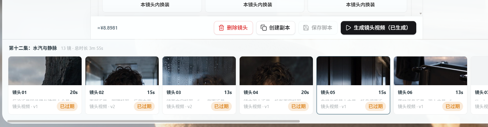

# 用户问题记录

按问题逐条追加，记录用户、截图（可选）、文案描述及答复 / 解决方式。没有截图时可省略截图项。

## 001 · 镜头视频全部显示“已过期”

- **用户**：罗香雪
- **文案描述**：怎么全显示过期了
- **答复 / 如何解决**：韩子续：是不是修改了整个剧情章节里的文本？过期不影响使用。
- **截图**：

## 002 · 生成白雪公主的视频时，没有用上参考声音

- **用户**：罗香雪
- **文案描述**：已经给白雪公主设置了参考声音，但生成视频时，系统没有把这段声音传给 AI。
- **影响**：生成的人声可能与设置的参考声音不一致，即使页面显示“生成成功”也可能出现这个问题。
- **状态**：待处理，下面的方法尚未确认能否解决这次问题。
- **答复 / 如何解决**：
  1. 确认已勾选“使用已绑定角色的声音样本”。
  2. 如果白雪公主在本镜头有台词，在提示词的“声音设计”里的“对白”部分写清楚：`白雪公主：“本镜头原有的台词”`。名字要与角色设置中的名称一致，不要为了使用参考声音额外增加台词。

  这样调整有可能让系统正确识别并使用参考声音；只写“请使用白雪公主的参考声音”可能不够。如果仍然没有用上参考声音，需要开发人员继续处理，不建议反复付费重试。
